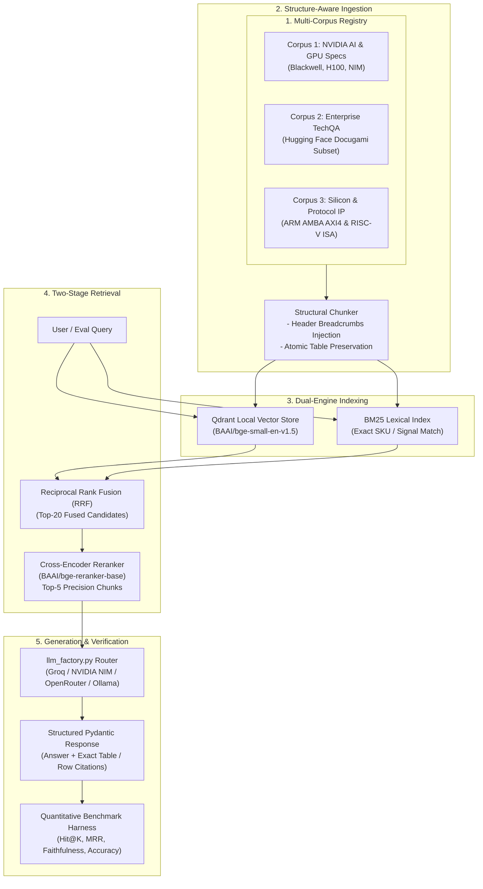

# SpecRAG: Structure-Aware Hybrid RAG with Cross-Encoder Reranking

[](https://www.python.org/downloads/)
[](https://opensource.org/licenses/MIT)
[](https://github.com/astral-sh/ruff)
[](https://qdrant.tech/)

> **Quantitative Proof that Naive RAG breaks on real-world hardware & enterprise specifications — and the production-grade architecture that fixes it.**

---

## 🎯 Motivation: Why "Chat with Docs" Fails in Enterprise Engineering

Most RAG tutorials implement naive 500-token fixed-window chunking and pure cosine similarity. In Senior AI Solution Architect & Forward Deployed Engineer technical interviews, this naive pattern is immediately exposed:

1. **Table & SKU Comparison Destruction:** In hardware datasheets (e.g. **NVIDIA H100 SXM5 vs. PCIe**, **Blackwell B200 vs. GB200 NVL72**), critical specs live in multi-column matrices (FP4/FP8 TFLOPS, HBM3e bandwidth, TDP). Fixed-window chunking severs headers from rows and loses context.
2. **Exact Identifier Blindness:** Dense embeddings excel at broad semantics, but fail on exact register addresses, protocol signals, or SKU identifiers (`AWVALID`, `NVLink-C2C`, `ERR_NVML_04`).
3. **Retrieval Precision Bottleneck:** Dense Top-$k$ returns noisy distractor chunks that induce LLM hallucinations.
4. **Generalization Gap:** Real-world architectures must generalize across different technical domains without brittle manual prompt hacks.

**SpecRAG** implements and quantitatively compares three progressive pipelines across **three distinct technical corpora**:
- **Pipeline 1 (Naive Baseline):** Fixed-window token chunking + Dense Vector Search (`BAAI/bge-small-en-v1.5`).
- **Pipeline 2 (Structure-Aware Hybrid):** Section-breadcrumb & table-preserving chunking + Dense (`Qdrant`) + Sparse (`BM25Okapi`) fused with **Reciprocal Rank Fusion (RRF)**.
- **Pipeline 3 (Hybrid + Cross-Encoder Reranking):** Two-stage retrieval passing fused Top-20 candidates to `BAAI/bge-reranker-base` for precision Top-5 selection.

---

## 🏗️ System Architecture



---

## ⚡ Zero-Cost Multi-Provider LLM Router

SpecRAG requires **\$0.00** in API bills. The built-in `llm_factory.py` implements an automated fallback cascade across free tiers:

$$\text{Groq (Llama 3.3 70B)} \longrightarrow \text{NVIDIA NIM} \longrightarrow \text{OpenRouter (:free)} \longrightarrow \text{GitHub Models} \longrightarrow \text{Local Ollama}$$

If a provider encounters rate limits (`HTTP 429`), the router smoothly falls back to the next available provider.

---

## 🚀 Quickstart

### 1. Prerequisites & Installation

Using [`uv`](https://docs.astral.sh/uv/) (recommended):

```bash
git clone https://github.com/<your-username>/specrag.git
cd specrag

# Create virtual environment and install dependencies
uv venv
# On Windows: .venv\Scripts\activate
# On Linux/macOS: source .venv/bin/activate

uv pip install -e ".[dev]"
```

### 2. Configure Environment

Copy the example configuration:

```bash
cp .env.example .env
```

Add at least one free API key (e.g. `GROQ_API_KEY`, `NVIDIA_API_KEY`, or `OPENROUTER_API_KEY`).

### 3. Download the Benchmark Datasets

```bash
uv run python -m scripts.download_datasets
```

This prepares the 3 evaluation corpora and their corresponding golden test suites:
- `data/nvidia_ai_hw/`
- `data/hf_tech_bench/`
- `data/arm_riscv_ip/`

### 4. Run the Evaluation Benchmark

```bash
# Benchmark all 3 pipelines on NVIDIA GPU Hardware specs
uv run python -m specrag.cli benchmark --dataset nvidia_ai_hw

# Compare results across all corpora
uv run python -m specrag.cli benchmark --all
```

---

## 📊 Evaluation & Metrics

The benchmark runner measures:
- **Deterministic Retrieval Metrics:**
  - `Context Recall @ K`
  - `MRR (Mean Reciprocal Rank)`
  - `Table & Exact Identifier Hit Rate`
  - `End-to-End Latency (ms)`
- **LLM-as-a-Judge Evaluation:**
  - `Faithfulness` (0.0 – 1.0; verifying zero hallucinated numerical specs)
  - `Answer Accuracy` (comparison against ground-truth technical specs)

Detailed benchmark tables are logged to `BENCHMARK_RESULTS.md`.

---

## 📁 Repository Structure

```text
specrag/
├── README.md                           # Architecture overview & setup guide
├── BENCHMARK_RESULTS.md                # Quantitative multi-corpus benchmark results
├── pyproject.toml                      # uv + ruff + pytest configuration
├── .env.example                        # Multi-provider zero-cost API template
├── scripts/
│   └── download_datasets.py            # Corpus fetcher & golden eval generator
├── data/
│   ├── nvidia_ai_hw/                   # NVIDIA Blackwell & H100 specs + eval set
│   ├── hf_tech_bench/                  # Hugging Face enterprise doc benchmark
│   └── arm_riscv_ip/                   # ARM AXI4 & RISC-V specs + eval set
├── notebooks/
│   └── SpecRAG_Colab_GPU_Benchmark.ipynb # Free Google Colab T4 GPU harness
├── src/
│   └── specrag/
│       ├── __init__.py
│       ├── config.py                   # Pydantic settings & model registry
│       ├── schemas.py                  # Chunk, Query, Citation, Response models
│       ├── llm_factory.py              # Zero-cost multi-provider LLM cascade router
│       ├── chunkers/
│       │   ├── naive_chunker.py        # Baseline fixed-window chunker
│       │   └── structural_chunker.py   # Table-preserving + header breadcrumb chunker
│       ├── retrievers/
│       │   ├── qdrant_store.py         # Local Qdrant dense vector index
│       │   ├── hybrid_rrf.py           # BM25 + Qdrant Reciprocal Rank Fusion
│       │   └── reranker.py             # Cross-Encoder (BAAI/bge-reranker-base)
│       ├── pipeline.py                 # Unified pipeline runner (Naive / Hybrid / Rerank)
│       ├── eval/
│       │   ├── metrics.py              # Deterministic & LLM-as-a-judge scorers
│       │   └── benchmark_runner.py     # Multi-corpus benchmark orchestrator
│       └── cli.py                      # Typer + Rich CLI interface
└── tests/
    ├── test_chunkers.py                # Table preservation unit tests
    ├── test_hybrid_rrf.py              # RRF math & identifier retrieval tests
    └── test_llm_factory.py             # Provider cascade fallback tests
```

---

## 📄 License

MIT License. See [LICENSE](LICENSE) for details.

