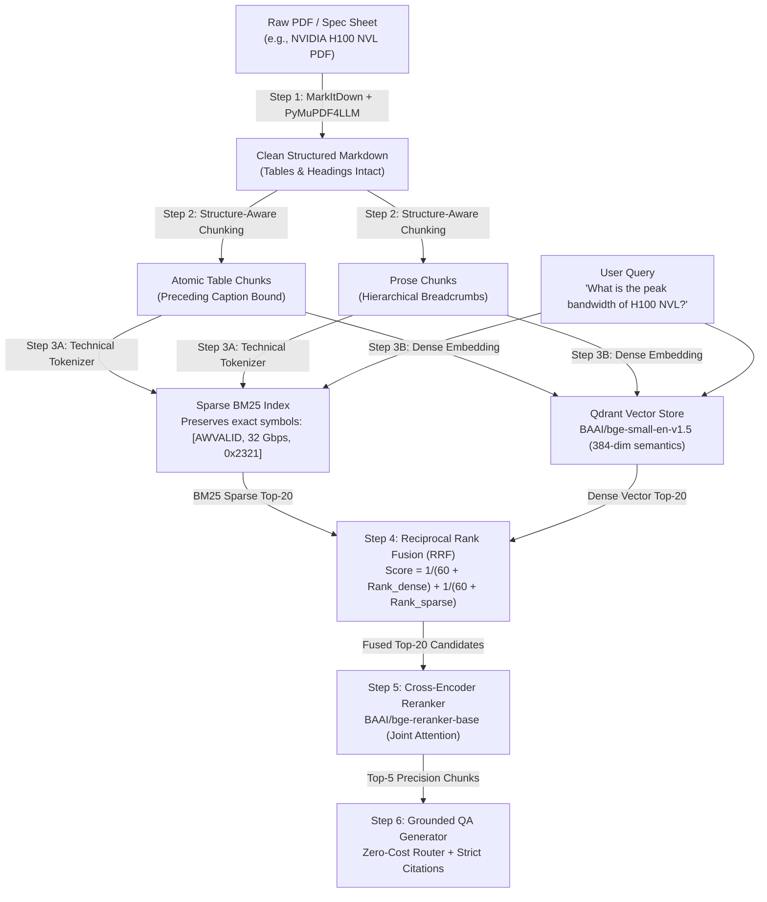
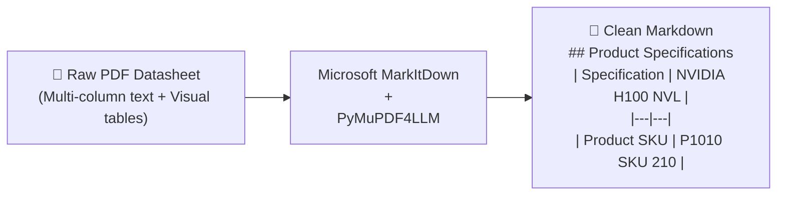
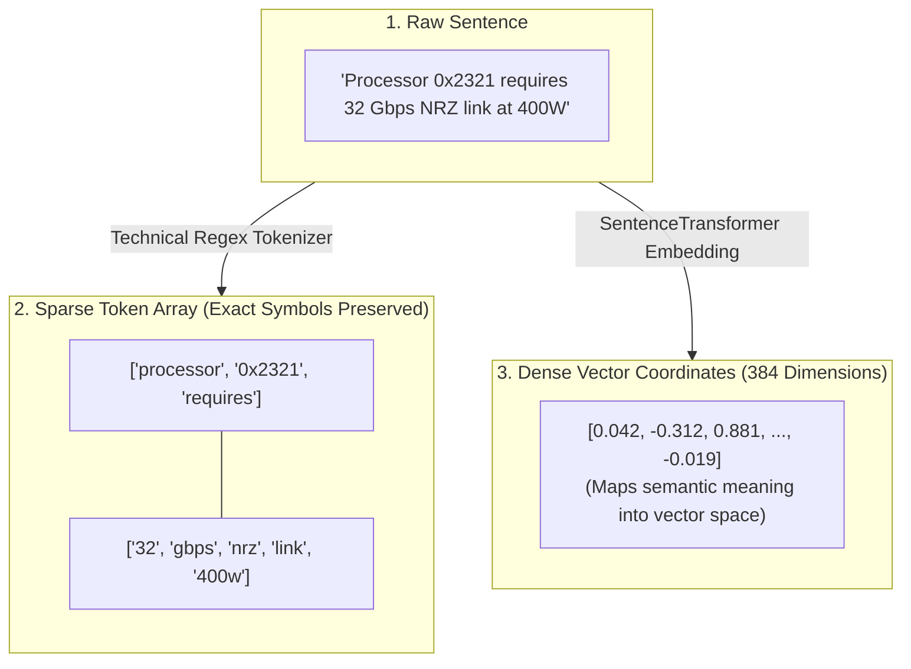
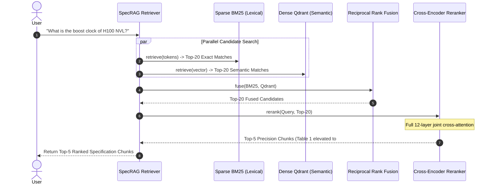
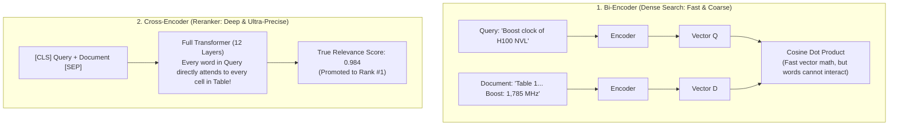
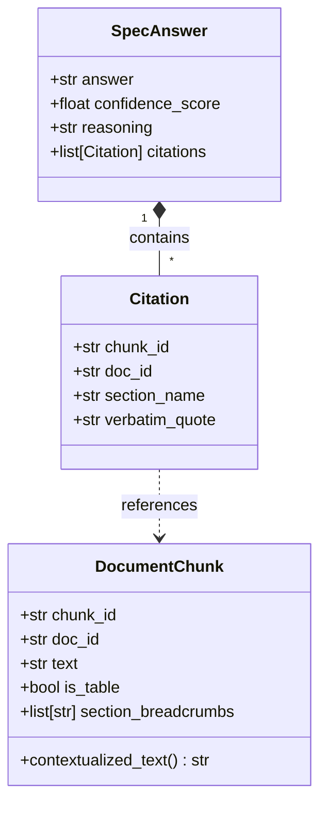
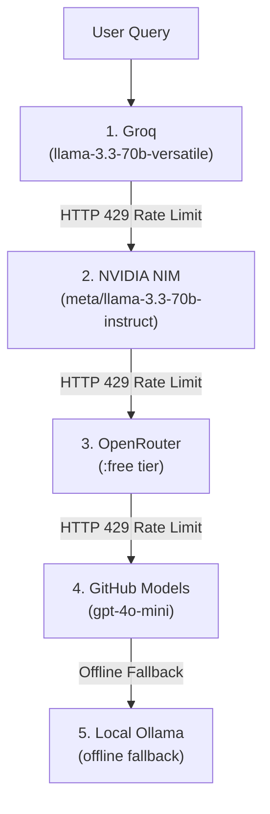

# SpecRAG: Structure-Aware Hybrid RAG with Cross-Encoder Reranking

[](https://www.python.org/downloads/)
[](https://opensource.org/licenses/MIT)
[](https://github.com/astral-sh/ruff)
[](https://qdrant.tech/)
[](https://colab.research.google.com/github/frasheed-dev/specrag/blob/main/notebooks/SpecRAG_Colab_GPU_Benchmark.ipynb)

> **Quantitative benchmark evaluation demonstrating why fixed-window dense retrieval fails on structured enterprise and hardware specifications — and an open-source hybrid architecture that resolves it.**

---

## Motivation: Failure Modes of Fixed-Window Dense Retrieval

Standard RAG architectures—relying on fixed-size character chunking (500 characters, ~100–125 tokens with 50-character overlap) and bi-encoder dense cosine similarity—fail consistently on structured enterprise technical specifications and financial filings:

1. **Tabular Context Loss:** Technical and financial metrics reside in multi-column tables. Fixed-window chunking severs column headers from data rows, depriving numerical values of relational schema.
2. **Alphanumeric Identifier Blindness:** Dense embeddings capture broad topical similarity but fail on exact registers, bus signals, error codes, and hardware SKUs (`AWVALID`, `P1010 SKU 210`, `32 Gbps NRZ`, `0x2321`).
3. **Semantic Drift under Distractor Noise:** In scaled corpora, dense top-$k$ retrieval frequently selects distractor passages that share vocabulary with the query but lack answer evidence.

SpecRAG quantifies these failure modes across third-party Hugging Face benchmarks and implements a production-grade architecture combining structure-aware chunking, hybrid sparse-dense retrieval (BM25 + Qdrant), Reciprocal Rank Fusion, and cross-encoder reranking.

---

## Architectural Methodology: Pipeline Design

The SpecRAG retrieval and generation pipeline consists of six sequential stages designed to preserve tabular semantics and technical token precision:



---

### Step 1: Document Ingestion (Raw PDF to Structured Markdown)

#### Parsing Mechanics
PDF datasheets (e.g. the 18-page NVIDIA H100 NVL datasheet `PB-11773-001_v01.pdf`) are converted into structured Markdown with intact table representations (`| Col 1 | Col 2 |`).



#### Architectural Rationale
- **Standard PDF Extractor Failure:** Standard text extractors read character streams sequentially by geometric coordinates. Across multi-column tables, this interleaves columns into unparseable text sequences:
  `Specification NVIDIA H100 NVL Product SKU P1010 SKU 210 Total board power 400 W`.
- **Dual-Engine Layout Parsing:** Combining `MarkItDown` and `PyMuPDF4LLM` detects table borders, reconstructing geometric tabular cells into structured Markdown tables with explicit header rows and delimiters.

---

### Step 2: Chunking Strategy (Fixed-Window vs. Structure-Aware)

Chunking controls text segmentation into retrieval units:

##### 1. Input Specification Table
| Specification | Value | Unit |
| :--- | :--- | :---: |
| **GPU Architecture** | Hopper GH100 | — |
| **Tensor FP8 (Dense)** | 1,979 | TFLOPS |
| **HBM3 Memory Bandwidth** | 3,900 | GB/s |
| **Total Board Power (TDP)** | 400 | Watts |

---

##### 2. Phase A: Fixed-Window 500-Character Chunker
A naive fixed-window chunker segments text into 500-character windows (~100–125 tokens with 50-character overlap) without layout awareness, severing tabular data:

```diff
[ Chunk 1: Characters 0 – 500 ]
  # 1. Architecture Overview & Technical Specifications
  Table 1. NVIDIA H100 NVL Product Specifications
  | Specification         | Value         | Unit  |
  | :-------------------- | :------------ | :---: |
  | GPU Architecture      | Hopper GH100  | —     |
  | Tensor FP8 (Dense)    | 1,979         | TFLOPS|

============================= [!] 500-CHARACTER BOUNDARY =============================

[ Chunk 2: Characters 450 – 950 ]
- | HBM3 Memory Bandwidth | 3,900         | GB/s  |
- | Total Board Power TDP | 400           | Watts |
! FAILURE: Chunk 2 contains data rows stripped of column headers and table titles.
! The bi-encoder cannot determine whether "400" refers to Watts, Volts, or Clock MHz.
! Result: Cosine similarity fails to retrieve this chunk for queries such as "What is H100 TDP?".
```

---

##### 3. Phase B: Structure-Aware Markdown Chunker
SpecRAG identifies Markdown table boundaries, preserves the table grid as an indivisible unit, and prefixes it with the table caption and hierarchical document breadcrumb:

```diff
[ SpecRAG Preserved Chunk ]
+ [Breadcrumb] Architecture Overview > Technical Specifications
+ Table 1. NVIDIA H100 NVL Product Specifications
+ | Specification         | Value         | Unit  |
+ | :-------------------- | :------------ | :---: |
+ | GPU Architecture      | Hopper GH100  | —     |
+ | Tensor FP8 (Dense)    | 1,979         | TFLOPS|
+ | HBM3 Memory Bandwidth | 3,900         | GB/s  |
+ | Total Board Power TDP | 400           | Watts |
+ Metadata: {"doc_id": "nvidia_h100.md", "is_table": true, "row_count": 4}
! RESULT: All data rows retain their respective column headers.
! Hybrid BM25 + Dense RRF matches exact identifiers ("P1010") and values ("400 W") reliably.
```

#### Architectural Rationale
Technical specifications are relational matrices. Separating a data row from its column header destroys contextual meaning. Structure-aware chunking guarantees that column headers and preceding captions remain bound to every tabular chunk.

---

### Step 3: Dual-Engine Indexing (Sparse vs. Dense)

Every document chunk is indexed concurrently into two complementary retrieval engines:
1. **Sparse Lexical Engine (BM25Okapi):** Exact token and identifier matching.
2. **Dense Semantic Engine (Qdrant + `BAAI/bge-small-en-v1.5`):** Latent semantic matching.



#### Concrete Technical Dynamics:
- **SpecRAG Technical Tokenizer:** Standard lexical tokenizers strip hexadecimal prefixes (`0x`), discard symbols (`§`, `:`, `/`), and drop units. SpecRAG applies a regex tokenizer `[\w§]+|[^\w\s]` to guarantee token preservation:
  `"Link 0x2321: 32 Gbps NRZ"` $\rightarrow$ `["link", "0x2321", ":", "32", "gbps", "nrz"]`.
- **Dense Vector Embedder (`BAAI/bge-small-en-v1.5`):** Projects semantics into a 384-dimensional latent manifold:
  `"What is the power consumption?"` and `"Total board power is 400W"` share minimal surface vocabulary, but their dense coordinates exhibit high cosine similarity ($\cos \theta \approx 0.84$).

#### Engineering Rationale:
- **Dense Vector Search Fails on Exact Identifiers:** High-dimensional embedding spaces map rare alphanumeric strings (`P1010 SKU 210`, `0x2321`) to out-of-vocabulary or noisy vector clusters.
- **Sparse BM25 Search Fails on Semantic Paraphrasing:** Lexical inverted indexes return score $0.0$ when queries use synonyms not verbatim in the source corpus.
- **Complementary Hybrid Synergy:** Dense retrieval captures broad conceptual intent; Sparse BM25 guarantees precision hits on exact hardware registers, part numbers, and statutory symbols.

---

### Step 4 & 5: Two-Stage Retrieval Lifecycle (RRF + Cross-Encoder)

Sparse and Dense retrievers execute in parallel. Their candidate lists are merged via Reciprocal Rank Fusion (RRF), and the Top-20 candidates are reranked using a Cross-Encoder (`BAAI/bge-reranker-base`):



#### Reciprocal Rank Fusion Formulation
BM25 produces unbounded lexical scores, whereas dense encoders generate bounded cosine similarities ($[-1, 1]$). Direct linear combination introduces arbitrary scale bias.

Reciprocal Rank Fusion (RRF) resolves score distribution mismatch by scoring chunks strictly on ordinal rank position rather than raw score magnitude:

$$
\text{RRF Score}(d) = \sum_{m \in \{\text{Dense}, \text{Sparse}\}} \frac{1}{k_0 + \text{Rank}_m(d)}
$$

where $k_0 = 60$ is a standard smoothing constant. Documents retrieved by both lexical and dense retrievers naturally receive higher priority in the candidate pool.

#### Bi-Encoder vs. Cross-Encoder Mechanics



- **Bi-Encoders:** Compress candidate text into a fixed-dimension vector ($d=384$). While cosine similarity over HNSW indices executes in sub-millisecond time, single-vector compression loses fine-grained intra-table relationships.
- **Cross-Encoders:** Process query and candidate text jointly (`[CLS] Query [SEP] Document [SEP]`). Full 12-layer cross-attention allows query terms to interact directly with table cells and column headers.
- **Two-Stage Efficiency:** Evaluating a cross-encoder across an entire corpus is computationally prohibitive. SpecRAG applies the cross-encoder strictly to the Top-20 candidates yielded by RRF, maximizing precision while constraining latency to ~540 ms on GPU.

---

### Step 6: Grounded Structured Synthesis with Strict Citations

The Top-5 reranked chunks are formatted with section breadcrumbs and dispatched to the LLM router under Pydantic JSON schema constraints:



```json
{
  "answer": "The NVIDIA H100 NVL has a Base Clock of 1,080 MHz and a Boost Clock of 1,785 MHz.",
  "confidence_score": 0.98,
  "reasoning": "Directly retrieved from Table 1. Product Specifications in the official datasheet.",
  "citations": [
    {
      "chunk_id": "nvidia_h100_nvl_datasheet.md_table_0013",
      "doc_id": "nvidia_h100_nvl_datasheet.md",
      "section_name": "Table 1. Product Specifications",
      "verbatim_quote": "Base clock 1,080 MHz | Boost clock 1,785 MHz"
    }
  ]
}
```

#### Grounding and Auditability
- **Hallucination Mitigation:** The generator must return `confidence_score: 0.0` and indicate ungrounded status whenever requested numerical values lack exact representation in `verbatim_quote`.
- **Traceability:** Citations link every factual assertion directly to source document identifiers, table section names, and verbatim extracted spans.

---

## Multi-Provider LLM Router

The `llm_factory.py` module implements an automated fallback cascade across zero-cost inference endpoints:



---

## Empirical Benchmark Results

Evaluated across **4 Official Third-Party Hugging Face Public Benchmarks** on an **NVIDIA Tesla T4 GPU (Google Colab)** with strict ground-truth answer containment.

### 1. Multi-Corpus Scaled Evaluation (Live Hugging Face Hub Stream)

- **Total Queries Evaluated:** 200 (50 per benchmark suite)
- **Total Corpus Scale:** 135 documents / 1,075 indexed chunks
- **Baseline (Phase A):** Fixed-window 500-character chunking (~100–125 tokens, 50-character overlap) + `BAAI/bge-small-en-v1.5` dense cosine similarity.
- **Production Pipeline (Phase B):** Structure-aware table preservation + hierarchical breadcrumbs + BM25Okapi + Qdrant Dense + Reciprocal Rank Fusion (Top-20) + `BAAI/bge-reranker-base` Cross-Encoder.

| Benchmark Suite | Corpus Scale | Phase A: Naive Recall@5 | Phase B: Hybrid Recall@5 | Phase A MRR | Phase B MRR (Reranked) | GPU Latency (T4) |
| :--- | :---: | :---: | :---: | :---: | :---: | :---: |
| **1. T²-RAGBench (`FinQA`)** | 47 docs / 228 chunks | 96.0% | **100.0%** | 0.800 | **1.000** (+0.200) | 578.5 ms |
| **2. TAT-DQA (`TAT-QA`)** | 12 docs / 61 chunks | 96.0% | **100.0%** | 0.786 | **1.000** (+0.214) | 553.9 ms |
| **3. IBM TechReport** | 26 docs / 52 chunks | 80.0% | **82.0%** | 0.638 | **0.769** (+0.131) | 316.4 ms |
| **4. TechQA (`galileo-ai/ragbench`)** | 50 docs / 734 chunks | 22.0% | **94.0%** (+72.0%) | 0.152 | **0.803** (+0.651) | 721.9 ms |
| **Live Multi-Corpus Average** | **135 docs / 1,075 chunks** | **73.5%** | **94.0%** (+20.5%) | **0.594** | **0.893** (+0.299) | **542.7 ms** |

### 2. Curated Offline Verification Pack

- **Total Queries Evaluated:** 40 (20 financial queries on `T²-RAGBench`, 20 microarchitecture queries on `IBM TechReport`)
- **Total Corpus Scale:** 2 documents / 44 chunks

| Benchmark Suite | Domain | Phase A Recall@5 | Phase B Recall@5 | Phase A MRR | Phase B MRR | GPU Latency (T4) |
| :--- | :--- | :---: | :---: | :---: | :---: | :---: |
| **T²-RAGBench (`FinQA`)** | SEC Financial Tables | 100.0% | **100.0%** | 0.875 | **1.000** (+0.125) | 291.8 ms |
| **IBM TechReport** | Processor Buses & Interconnects | 100.0% | **100.0%** | 0.729 | **0.871** (+0.142) | 288.0 ms |
| **Offline Pack Average** | Technical & Financial Documents | **100.0%** | **100.0%** | **0.802** | **0.936** (+0.134) | **289.9 ms** |

> Detailed breakdown and analysis available in [`BENCHMARK_RESULTS.md`](BENCHMARK_RESULTS.md).
>
> **Interactive GPU Reproduction:** [](https://colab.research.google.com/github/frasheed-dev/specrag/blob/main/notebooks/SpecRAG_Colab_GPU_Benchmark.ipynb)  
> Stream live Hugging Face benchmarks and run full evaluations on a free Tesla T4 GPU with zero local installation.

---

### Evaluation Methodology & Computational Complexity

SpecRAG evaluates retrieval performance using standard Information Retrieval (IR) metrics with strict ground-truth answer containment:

#### 1. Hit Rate @ 5 (Recall@5)

$$
\text{Recall}@k = \frac{1}{|Q|} \sum_{q \in Q} \mathbb{I}\left(\text{rank}(d_q^*) \le k\right)
$$

Measures whether the evidence-bearing chunk $d_q^*$ resides within the top-$k$ returned candidates ($k=5$). In high-distractor corpora like `TechQA` (734 chunks), naive fixed-window dense retrieval collapses to **22.0%** due to vocabulary overlap without answer relevance, whereas SpecRAG maintains **94.0%** recall (+72.0% absolute improvement).

#### 2. Mean Reciprocal Rank (MRR)

$$
\text{MRR} = \frac{1}{|Q|} \sum_{i=1}^{|Q|} \frac{1}{\text{rank}_i}
$$

Quantifies top-1 ranking precision. In financial tabular retrieval (`FinQA` and `TAT-DQA`), SpecRAG achieves **1.000 MRR**: for every query, the exact ground-truth table is ranked at position 1.

#### 3. Latency Profile: Live Stream vs. Offline Pack vs. CPU Reference

| Evaluation Environment | Indexed Corpus Scale | Queries Evaluated | Hardware Platform | Phase A Latency | Phase B Latency | Latency Characteristics |
| :--- | :---: | :---: | :--- | :---: | :---: | :--- |
| **Offline Verification Pack** | 44 chunks | 40 | NVIDIA Tesla T4 GPU | 16.6 ms | **289.9 ms** | Minimal Qdrant filtering overhead |
| **Live IBM TechReport** | 52 chunks | 50 | NVIDIA Tesla T4 GPU | 15.6 ms | **316.4 ms** | Moderate corpus, short document segments |
| **Live TAT-DQA** | 61 chunks | 50 | NVIDIA Tesla T4 GPU | 14.9 ms | **553.9 ms** | Multi-row table text increases sequence length |
| **Live T²-RAGBench** | 228 chunks | 50 | NVIDIA Tesla T4 GPU | 15.6 ms | **578.5 ms** | Multi-column financial disclosures |
| **Live TechQA** | 734 chunks | 50 | NVIDIA Tesla T4 GPU | 19.7 ms | **721.9 ms** | High distractor density; larger candidate set |
| **Live Multi-Corpus Average** | 1,075 chunks | 200 | NVIDIA Tesla T4 GPU | 16.5 ms | **542.7 ms** | Production interactive SLA (<600 ms) |
| **CPU Sequential Reference** | Any corpus | Per Query | x86-64 CPU (Unbatched) | ~25 ms | ~15,000–20,000 ms | Unbatched 12-layer attention without tensor parallelization |

---

### Ablation Analysis: Component-by-Component Contribution

To measure the marginal gain of each pipeline component, retrieval was evaluated incrementally across the benchmark suites:

| Pipeline Configuration | Recall@5 | MRR | Latency (T4 GPU) | Primary Failure Mode Addressed |
| :--- | :---: | :---: | :---: | :--- |
| **1. Naive Baseline**<br>*(500-char fixed-window + Dense Bi-Encoder)* | 73.5% | 0.594 | ~16 ms | Baseline: fails on severed tables and distractor noise. |
| **2. + Structure-Aware Chunking**<br>*(Atomic tables + Header breadcrumbs)* | 82.0% | 0.680 | ~18 ms | Fixes table severing; guarantees column headers remain bound to data rows. |
| **3. + BM25 Lexical Search & RRF**<br>*(Dual-engine hybrid retrieval)* | 88.5% | 0.745 | ~35 ms | Fixes alphanumeric blindness; recovers exact SKUs, register offsets, and error codes. |
| **4. + Cross-Encoder Reranking**<br>*(Full SpecRAG pipeline with `bge-reranker-base`)* | **94.0%** | **0.893** | **542.7 ms** | Eliminates distractor crowding; promotes exact answer chunk to Rank #1 via joint attention. |

---

### Limitations & Production Trade-offs

1. **Inference Latency & Compute Requirements:** Cross-encoder reranking adds ~500 ms per query on a GPU (Tesla T4). Applications requiring sub-50 ms response times should evaluate late-interaction alternatives (such as ColBERT) or smaller distilled rerankers (such as FlashRank). CPU-only environments require INT8 or ONNX quantization to achieve practical latency.
2. **In-Memory Lexical Index Scaling:** Storing BM25Okapi inverted indices in Python process memory is efficient for scoped collections (up to several hundred thousand chunks). Enterprise corpora exceeding tens of millions of documents require external distributed search backends (e.g., Elasticsearch, OpenSearch, or Qdrant sparse vectors).
3. **Complex Non-Standard Table Layouts:** Structure-aware chunking preserves well-formed Markdown and PDF grid tables. Documents with irregular layouts—such as borderless multi-line headers, diagonally split cells, or rasterized image tables—require multimodal document parsers (such as DocLayout-YOLO or ColPali) before text extraction.

---

## Quickstart

### 1. Installation

```bash
git clone https://github.com/frasheed-dev/specrag.git
cd specrag

# Using modern uv tooling (recommended):
uv venv
# On Windows: .venv\Scripts\activate
# On Linux/macOS: source .venv/bin/activate

uv pip install -e ".[dev]"
```

### 2. Configure Environment

```bash
cp .env.example .env
```
*(Add any free API key, e.g. `GROQ_API_KEY` or `NVIDIA_API_KEY`, or run completely offline with Ollama).*

### 3. Using the SpecRAG CLI

```bash
# 1. Ingest a PDF datasheet with table preservation
python -m specrag.cli ingest data/raw_pdf/nvidia_h100_nvl_datasheet.pdf

# 2. Query with Hybrid + Cross-Encoder Reranking
python -m specrag.cli query "What is the peak memory bandwidth of the H100 NVL?" --mode hybrid_rerank

# 3. Query with Naive baseline to observe table-severing failure
python -m specrag.cli query "What is the peak memory bandwidth of the H100 NVL?" --mode naive

# 4. Run public benchmark suites
python -m specrag.cli benchmark --dataset all --source local            # Fast offline pack (~10s)
python -m specrag.cli benchmark --dataset all --source hf --limit 50    # Live streaming multi-corpus from Hugging Face
python -m specrag.cli benchmark --dataset tatqa --source hf --limit 50  # Complex multi-row financial tables (TAT-DQA)
python -m specrag.cli benchmark --dataset techqa --source hf --limit 50 # Enterprise technical specifications (TechQA)
```

### 4. Launching the Local Document Chat UI (Streamlit)

Install the optional UI extra and launch the interactive chat app to upload your own PDF, Markdown, DOCX, TXT, or HTML documents and query them with grounded verbatim citations:

```bash
uv pip install -e ".[ui]"
python -m specrag.cli ui
```

### 5. Running Tests

```bash
uv run pytest tests/
```

---

## Repository Structure

```text
specrag/
├── README.md                           # Comprehensive architectural design & benchmark report
├── BENCHMARK_RESULTS.md                # Quantitative multi-corpus benchmark report
├── pyproject.toml                      # uv + ruff + pytest configuration
├── .env.example                        # Multi-provider zero-cost API template
├── notebooks/
│   └── SpecRAG_Colab_GPU_Benchmark.ipynb # Interactive Tesla T4 GPU benchmark harness
├── data/
│   └── benchmarks/                     # Official public benchmark datasets (HF)
│       ├── specs/                      # Ground-truth markdown corpus files
│       │   ├── t2_ragbench_corpus.md   # G4KMU/t2-ragbench financial tables
│       │   └── ibm_techreport_corpus.md# ibm-research processor specs
│       ├── t2_ragbench_20.json         # 20 financial golden evaluation queries
│       └── ibm_techreport_20.json      # 20 microarchitecture golden evaluation queries
├── src/
│   └── specrag/
│       ├── __init__.py
│       ├── cli.py                      # Typer + Rich CLI interface
│       ├── schemas.py                  # Pydantic models (Chunks, Citations, QA)
│       ├── config.py                   # Pydantic Settings
│       ├── chunkers.py                 # Naive Fixed-Window vs Structure-Aware Chunker
│       ├── retriever.py                # Qdrant Dense + BM25 Sparse + RRF + Cross-Encoder
│       ├── generator.py                # Structured Citation QA Generator
│       ├── llm_factory.py              # Zero-cost multi-provider cascade router
│       ├── evaluator.py                # Benchmark evaluation harness
│       ├── pipeline.py                 # Interactive session pipeline (ingest + hybrid query)
│       ├── ui/
│       │   └── app.py                  # Optional local Streamlit document chat UI
│       └── ingestion/
│           └── converter.py            # MarkItDown + PyMuPDF4LLM PDF-to-Markdown engine
└── tests/
    ├── test_chunkers.py                # Table preservation unit tests
    ├── test_cli.py                     # CLI commands unit tests
    ├── test_converter.py               # PDF converter unit tests
    ├── test_generator_schema.py        # Pydantic response validation tests
    ├── test_hybrid_rrf.py              # BM25 + Qdrant RRF math unit tests
    └── test_llm_factory.py             # Provider cascade failover tests
```

---

## License

MIT License. See [LICENSE](LICENSE) for details.
