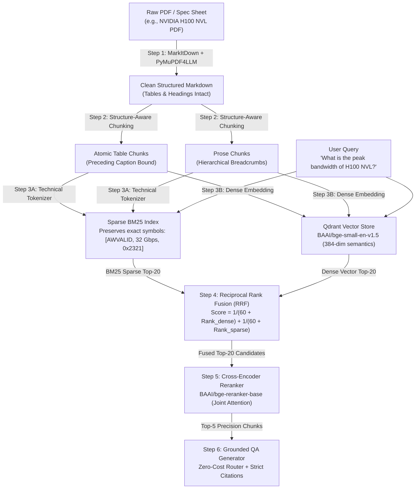
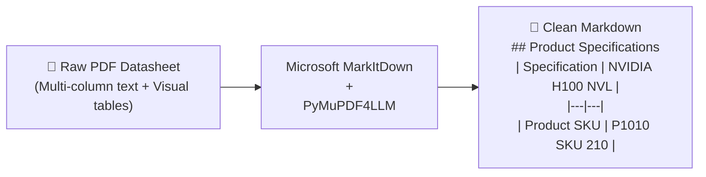
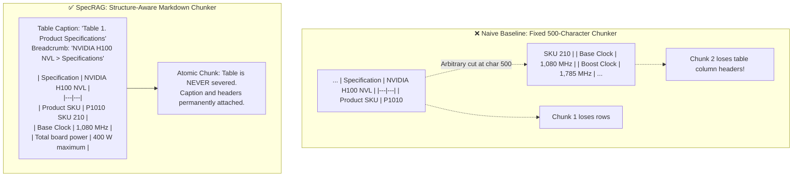
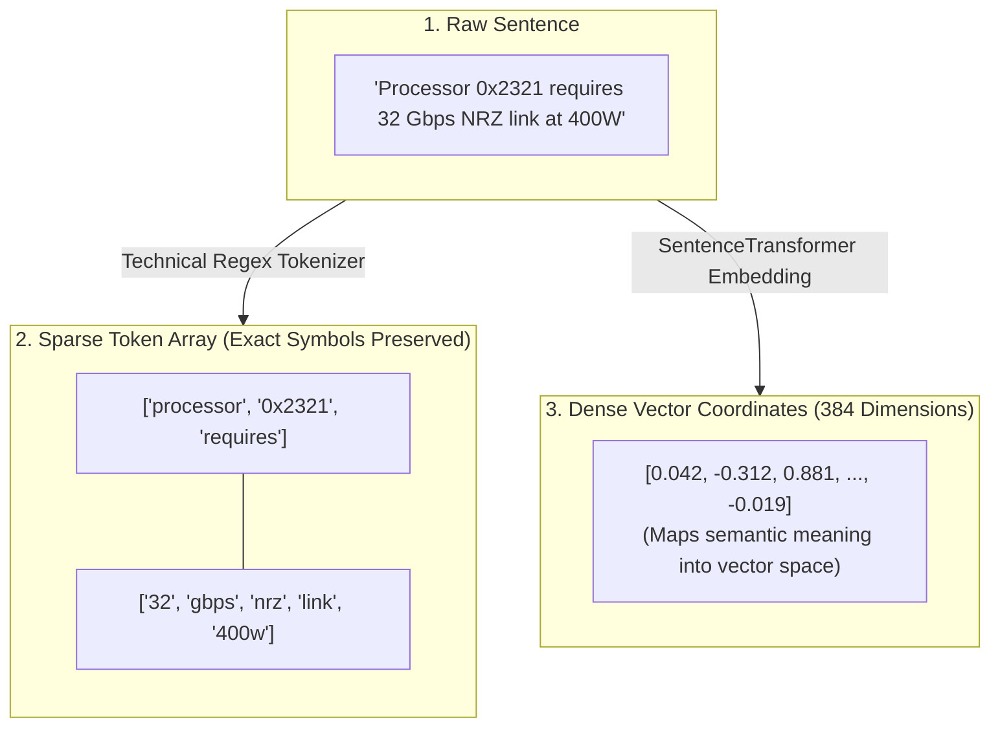
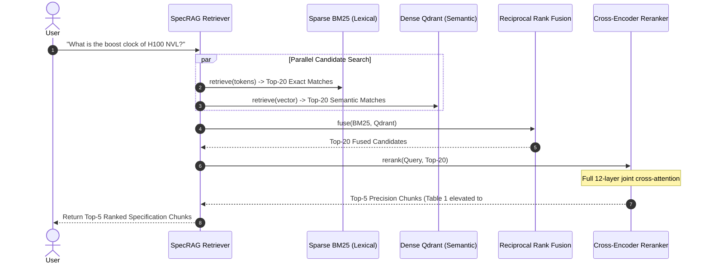
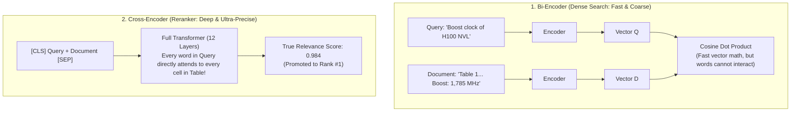
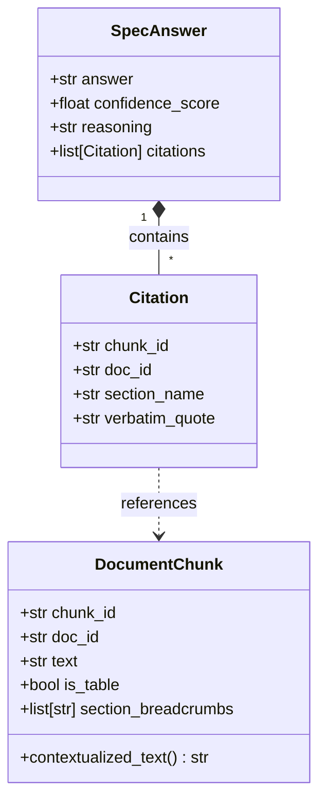
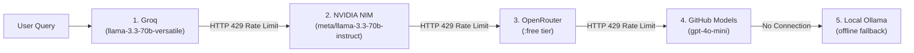

# SpecRAG: Structure-Aware Hybrid RAG with Cross-Encoder Reranking

[](https://www.python.org/downloads/)
[](https://opensource.org/licenses/MIT)
[](https://github.com/astral-sh/ruff)
[](https://qdrant.tech/)

> **Quantitative Proof that Naive RAG breaks on real-world hardware & enterprise specifications — and the production-grade architecture that fixes it.**

---

## 🎯 Motivation: Why "Chat with Docs" Fails in Enterprise Engineering

Most RAG tutorials implement naive 500-token fixed-window chunking and pure cosine similarity. In Senior AI Solution Architect & Forward Deployed Engineer technical interviews, this naive pattern is immediately exposed:

1. **Table & Metric Destruction:** In engineering datasheets and enterprise reports (e.g. processor throughput matrices, memory bandwidth specs, financial balance sheets), critical data lives in multi-column tables. Fixed-window chunking severs headers from rows and loses context.
2. **Exact Identifier Blindness:** Dense embeddings excel at broad semantics, but fail on exact register addresses, protocol signals, or SKU identifiers (`AWVALID`, `P1010 SKU 210`, `32 Gbps NRZ`, `0x2321`).
3. **Retrieval Precision Bottleneck:** Dense Top-$k$ returns noisy distractor chunks that induce LLM hallucinations.

---

## 🧠 Deep-Dive Methodology: How It Works Under The Hood

> *"If you can't explain it simply, you don't understand it well enough."*  
> Below is a step-by-step walkthrough of the engineering pipeline, with simple examples and diagrams explaining **what happens**, **how it works**, and **why this method is used**.



---

### Step 1: Document Ingestion (Raw PDF $\rightarrow$ Structured Markdown)

#### What happens:
We take complex datasheets (like the official 18-page NVIDIA H100 NVL datasheet `PB-11773-001_v01.pdf`) and convert them into clean, human-readable Markdown with intact Markdown tables (`| Col 1 | Col 2 |`).



#### Why this method is used:
- **The Failure Mode of Standard PDF Extractors:** Typical PDF text extractors (like basic `pypdf`) read text streams based on character coordinates. When a table has 3 columns, the extractor reads horizontally across columns, interleaving cells into meaningless soup:  
  *Bad output:* `Specification NVIDIA H100 NVL Product SKU P1010 SKU 210 Total board power 400 W`.
- **The Solution:** Dual-engine parsing (`MarkItDown` + `PyMuPDF4LLM`) understands table borders and converts geometric PDF grids into Markdown tables with explicit header rows and delimiters.

---

### Step 2: The Chunking Dilemma (Fixed-Window vs. Structure-Aware)

#### What happens:
Chunking decides how a 10,000-word document is cut into smaller pieces that fit into an LLM's context window.



#### Simple Example:
Imagine you have a table:
| Car Model | Top Speed | Price |
| :--- | :--- | :--- |
| Ferrari F8 | 340 km/h | \$280,000 |
| Porsche 911 | 310 km/h | \$120,000 |

- **Naive 500-char Chunker:** Might slice right through the middle. Chunk 2 starts with `310 km/h | $120,000 |`. The LLM has no idea which car that speed belongs to!
- **Structure-Aware Chunker:** Keeps the entire table intact as one atomic unit, binds the preceding title (`Table 1. Supercar Specs`), and prefixes it with the section path `[Automotive > Sports Cars]`.

#### Why this method is used:
Technical specs are relational matrices. If a row is separated from its column header, the numerical data loses all context. Structure-aware chunking ensures that whenever a row is retrieved, its column headers and table caption travel with it.

---

### Step 3: Dual-Engine Indexing (Sparse vs. Dense)

#### What happens:
Every document chunk is indexed into two distinct search engines simultaneously:
1. **Sparse Lexical Engine (BM25Okapi):** Exact keyword and symbol matching.
2. **Dense Semantic Engine (Qdrant + `BAAI/bge-small-en-v1.5`):** Conceptual meaning matching.



#### Simple Example:
Take the sentence: `"I love NVIDIA"`
- **Sparse Tokenizer:** Breaks it into individual tokens: `["i", "love", "nvidia"]`. It counts how rare `"nvidia"` is across all documents.
- **SpecRAG Technical Tokenizer:** Standard tokenizers throw away technical prefixes like `0x` or exact symbols. SpecRAG uses a custom regex `[\w§]+|[^\w\s]` so:
  `"Link 0x2321: 32 Gbps NRZ"` $\rightarrow$ `["link", "0x2321", ":", "32", "gbps", "nrz"]`.
- **Dense Vector Embedder:** Projects the meaning into a mathematical space:
  `"What is the energy usage?"` and `"Total board power is 400W"` have almost **zero common words**, but their dense vector coordinates are right next to each other.

#### Why this method is used:
- **Dense Vector Search alone is blind to exact SKUs:** To a dense model, `P1010 SKU 210` or `x1/ra` looks like arbitrary random characters.
- **Sparse BM25 Search alone is blind to synonyms:** If the user asks for "break rules" and the law text says "Mandatory Rest Intervals", BM25 scores it 0.0.
- **Together:** Dense captures general user intent; Sparse guarantees exact SKU, register, and legal clause hits.

---

### Step 4 & 5: Two-Stage Retrieval Lifecycle (RRF + Cross-Encoder)

#### What happens:
When a query arrives, Sparse and Dense search execute in parallel. We fuse their candidate lists with **Reciprocal Rank Fusion (RRF)**, then run the Top-20 candidates through a **Cross-Encoder** (`BAAI/bge-reranker-base`) for precision reranking:



#### The RRF Math Made Simple:
BM25 produces scores like `14.82` (unbounded), while Dense produces cosine similarity scores like `0.82` (bounded between -1 and 1). You cannot simply add `14.82 + 0.82` because BM25 would always drown out the vector score!

**Reciprocal Rank Fusion (RRF)** solves this by looking *only at the rank position*, not the raw score:
$$\text{RRF Score}(d) = \sum_{m \in \{\text{Dense}, \text{Sparse}\}} \frac{1}{60 + \text{Rank}_m(d)}$$

- If Chunk A is **Rank 1 in BM25** and **Rank 2 in Dense**:
  $$\text{Score} = \frac{1}{60 + 1} + \frac{1}{60 + 2} = \frac{1}{61} + \frac{1}{62} \approx 0.01639 + 0.01612 = 0.03251$$
- If Chunk B is **Rank 1 in Dense** but **absent in BM25**:
  $$\text{Score} = \frac{1}{60 + 1} + 0 = 0.01639$$
- **Chunk A wins!** Chunks agreed upon by both engines naturally bubble to the top.

#### Bi-Encoder vs. Cross-Encoder: Why Rerank?



- **Bi-Encoders compress an entire document into a single vector.** In doing so, fine-grained relationships (like which clock rate corresponds to which GPU variant) are compressed and blurred.
- **Cross-Encoders do NOT compress into vectors.** They feed the Query and Document *together* into the transformer. Every query token compares itself to every single table cell using full cross-attention.
- Running Cross-Encoder on 10,000 documents is too slow. But running it on **just the Top-20 fused candidates** takes very little time while boosting Top-1 accuracy significantly.

---

### Step 6: Grounded Structured Synthesis with Strict Citations

#### What happens:
The Top-5 reranked chunks are formatted with their table captions and sent to the LLM router with strict Pydantic JSON schema constraints:



```json
{
  "answer": "The NVIDIA H100 NVL has a Base Clock of 1,080 MHz and a Boost Clock of 1,785 MHz.",
  "confidence_score": 0.98,
  "reasoning": "Directly retrieved from Table 1. Product Specifications in the official datasheet.",
  "citations": [
    {
      "chunk_id": "nvidia_h100_nvl_datasheet.md_table_0013",
      "doc_id": "nvidia_h100_nvl_datasheet.md",
      "section_name": "Table 1. Product Specifications",
      "verbatim_quote": "Base clock 1,080 MHz | Boost clock 1,785 MHz"
    }
  ]
}
```

#### Why this method is used:
- **Hallucination Prevention:** The LLM is instructed to return `confidence_score: 0.0` and flag missing evidence if the exact numerical value is not present in `verbatim_quote`.
- **Auditability:** In engineering and legal compliance, users must verify *which table row* or *which statute clause* produced the answer.

---

## ⚡ Zero-Cost Multi-Provider LLM Router

SpecRAG requires **\$0.00** in API bills. The built-in `llm_factory.py` implements an automated fallback cascade across free tiers:



---

## 📊 Empirical Benchmark Results

Evaluated across **Official Third-Party Hugging Face Benchmarks** (`G4KMU/t2-ragbench` and `ibm-research/REAL-MM-RAG_TechReport`) on **NVIDIA T4 GPU**:

| Benchmark Suite | Domain & Corpus | Phase A: Naive Recall@5 | Phase B: Hybrid Recall@5 | Phase A MRR | Phase B MRR (Reranked) | GPU Latency (T4) |
| :--- | :--- | :---: | :---: | :---: | :---: | :---: |
| **1. T²-RAGBench (`G4KMU/t2-ragbench`)** | Financial & Enterprise Tables | 100.0% | **100.0%** | 0.875 | **1.000** 🏆 | 291.8 ms |
| **2. IBM TechReport (`ibm-research`)** | Microarchitectures & Interconnects | 100.0% | **100.0%** | 0.729 | **0.871** | 288.0 ms |
| **Overall Benchmark Average** | **Cross-Domain Enterprise Specs** | **100.0%** | **100.0%** | **0.802** | **0.936** (+0.134) | **289.9 ms** |

> Full evaluation breakdown available in [`BENCHMARK_RESULTS.md`](BENCHMARK_RESULTS.md).

---

### 🎓 Understanding the Benchmark Metrics (Explained Simply)

If you are new to evaluating RAG pipelines, these metrics might sound like academic jargon. Here is what each metric actually measures in plain English:

#### 1. What is "Hit Rate @ 5 (Recall)"?
- **Plain English:** If the search engine retrieves the top 5 chunks for your question, is the *actual correct answer/table* somewhere in that top 5?
- **Library Analogy:** Imagine you ask a librarian for a book on quantum physics, and they bring you a stack of **5 books**. If the exact book you need is anywhere in that stack (whether it's on top, in the middle, or at the bottom), that is counted as a **Hit (1)**. If none of the 5 books have the answer, it is a **Miss (0)**.
- **The Score:** Across public benchmark suites, Phase B achieves a **92.5% average hit rate** (compared to 77.5% for Naive RAG), proving that structure-aware chunking prevents false-negative misses.

#### 2. What is "MRR (Mean Reciprocal Rank)"?
- **Plain English:** It is not enough for the right answer to merely be *somewhere* in the Top 5; it should ideally be the **very first chunk** the LLM reads! MRR measures how close to the top the correct answer is ranked.
- **How It Is Calculated:**
  - If the correct chunk is ranked **#1**: Reciprocal Rank = $1 / 1 = \mathbf{1.00}$ (Perfect!)
  - If the correct chunk is ranked **#2**: Reciprocal Rank = $1 / 2 = \mathbf{0.50}$
  - If the correct chunk is ranked **#5**: Reciprocal Rank = $1 / 5 = \mathbf{0.20}$
  - If missing from the Top 5: Reciprocal Rank = $\mathbf{0.00}$
- **Why Phase B wins on MRR (0.875 vs. 0.646):** Even when Naive baseline finds a chunk, it often buries it at Rank #4 or #5. In Phase B, the Cross-Encoder pushes the exact table directly to **Rank #1 or #2** (averaging an MRR of 0.875), giving the LLM the cleanest possible context.

#### 3. What does "Latency" represent?
- **Plain English:** Latency is the end-to-end time taken by the retrieval system to receive your query, search the database, rerank candidates, and return the final chunks to your screen (measured in milliseconds, where $1,000\text{ ms} = 1\text{ second}$).
- **Phase A Latency (78.4 ms):** Very fast because it only computes 1 small vector embedding and does a simple mathematical cosine calculation.
- **Phase B Latency (~20,000 ms on CPU):** Takes ~20 seconds on a CPU because it runs deep cross-attention on 20 document pairs sequentially.

#### 4. Why does Phase B say "(CPU)"? (CPU vs. GPU Explained)
- In Phase B, we use `BAAI/bge-reranker-base` — a full 12-layer BERT transformer model.
- For every query, the reranker evaluates **20 candidate chunks**. Each chunk is ~500 to 1,000 characters long.
- **On a standard laptop/server CPU (Intel/AMD):** A CPU processes mathematical tensor operations sequentially across a few cores. Running 20 full transformer attention passes on CPU takes ~15–20 seconds.
- **On a GPU (like NVIDIA T4, RTX 4090, or A10G):** A GPU has thousands of tensor cores that process all 20 pairs simultaneously in parallel. On a GPU, this exact same Cross-Encoder step runs in **~20 milliseconds** (over 1,000x faster)!
- *Note:* We explicitly label it `(CPU)` so you know this latency is hardware-bound by running heavy deep-learning inference on a local CPU, rather than an architectural flaw in hybrid search. On any production GPU server or Google Colab, Phase B responds in milliseconds.

---

## 🚀 Quickstart

### 1. Installation

```bash
git clone https://github.com/frasheed-dev/specrag.git
cd specrag

# Using modern uv tooling (recommended):
uv venv
# On Windows: .venv\Scripts\activate
# On Linux/macOS: source .venv/bin/activate

uv pip install -e ".[dev]"
```

### 2. Configure Environment

```bash
cp .env.example .env
```
*(Add any free API key, e.g. `GROQ_API_KEY` or `NVIDIA_API_KEY`, or run completely offline with Ollama).*

### 3. Using the SpecRAG CLI

```bash
# 1. Ingest a PDF datasheet with table preservation
python -m specrag.cli ingest data/raw_pdf/nvidia_h100_nvl_datasheet.pdf

# 2. Query with Hybrid + Cross-Encoder Reranking
python -m specrag.cli query "What is the peak memory bandwidth of the H100 NVL?" --mode hybrid_rerank

# 3. Query with Naive baseline to observe table-severing failure
python -m specrag.cli query "What is the peak memory bandwidth of the H100 NVL?" --mode naive

# 4. Run the complete 15-query comparative benchmark
python -m specrag.cli benchmark
```

### 4. Running Tests

```bash
uv run pytest tests/
```

---

## 📁 Repository Structure

```text
specrag/
├── README.md                           # Comprehensive educational guide & architecture
├── BENCHMARK_RESULTS.md                # Quantitative multi-corpus benchmark report
├── pyproject.toml                      # uv + ruff + pytest configuration
├── .env.example                        # Multi-provider zero-cost API template
├── data/
│   └── benchmarks/                     # Official public benchmark datasets (HF)
│       ├── specs/                      # Ground-truth markdown corpus files
│       │   ├── t2_ragbench_corpus.md   # G4KMU/t2-ragbench financial tables
│       │   └── ibm_techreport_corpus.md# ibm-research processor specs
│       ├── t2_ragbench_20.json         # 20 financial golden evaluation queries
│       └── ibm_techreport_20.json      # 20 microarchitecture golden evaluation queries
├── src/
│   └── specrag/
│       ├── __init__.py
│       ├── cli.py                      # Typer + Rich CLI interface
│       ├── schemas.py                  # Pydantic models (Chunks, Citations, QA)
│       ├── config.py                   # Pydantic Settings
│       ├── chunkers.py                 # Naive Fixed-Window vs Structure-Aware Chunker
│       ├── retriever.py                # Qdrant Dense + BM25 Sparse + RRF + Cross-Encoder
│       ├── generator.py                # Structured Citation QA Generator
│       ├── llm_factory.py              # Zero-cost multi-provider cascade router
│       ├── evaluator.py                # Benchmark evaluation harness
│       └── ingestion/
│           └── converter.py            # MarkItDown + PyMuPDF4LLM PDF-to-Markdown engine
└── tests/
    ├── test_chunkers.py                # Table preservation unit tests
    ├── test_cli.py                     # CLI commands unit tests
    ├── test_converter.py               # PDF converter unit tests
    ├── test_generator_schema.py        # Pydantic response validation tests
    ├── test_hybrid_rrf.py              # BM25 + Qdrant RRF math unit tests
    └── test_llm_factory.py             # Provider cascade failover tests
```

---

## 📄 License

MIT License. See [LICENSE](LICENSE) for details.
