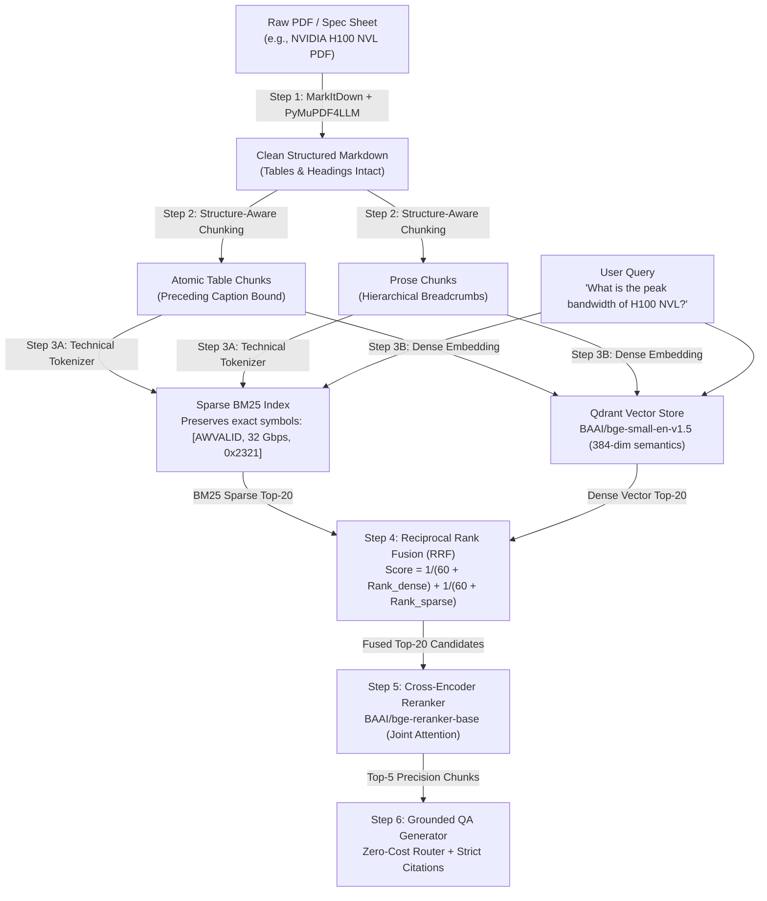
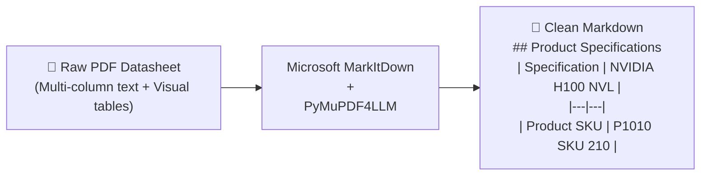
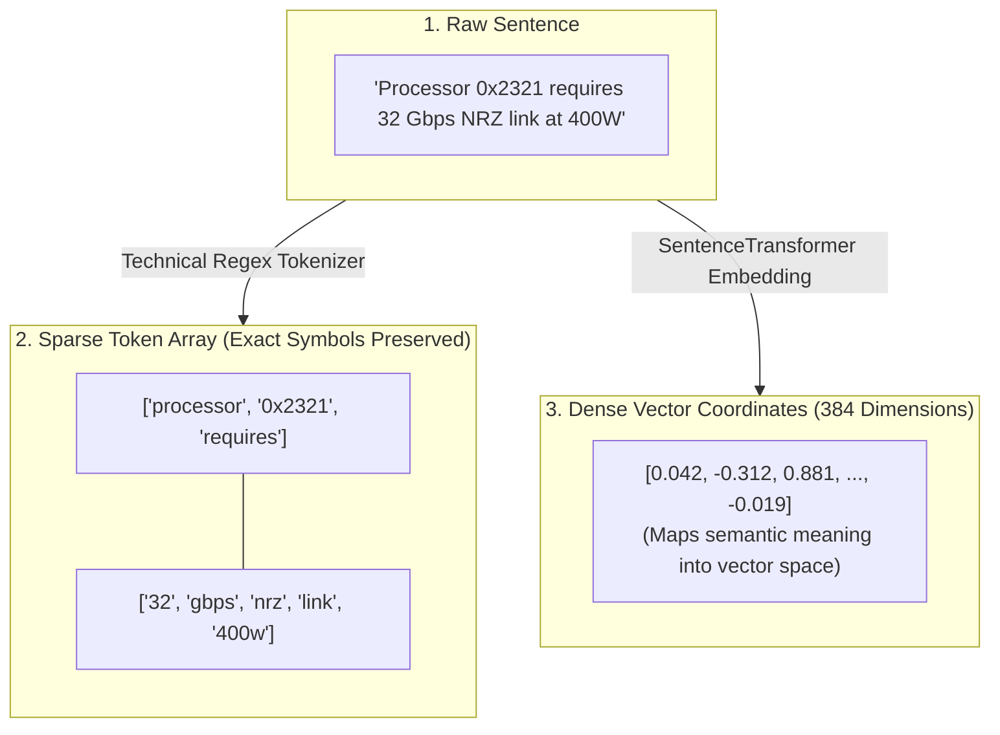
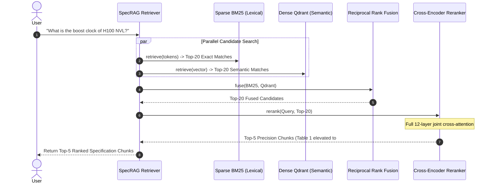
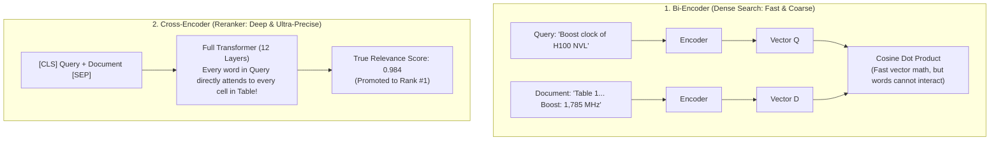
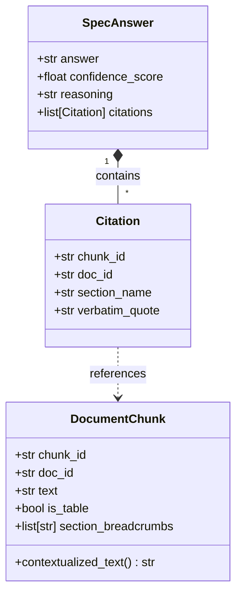
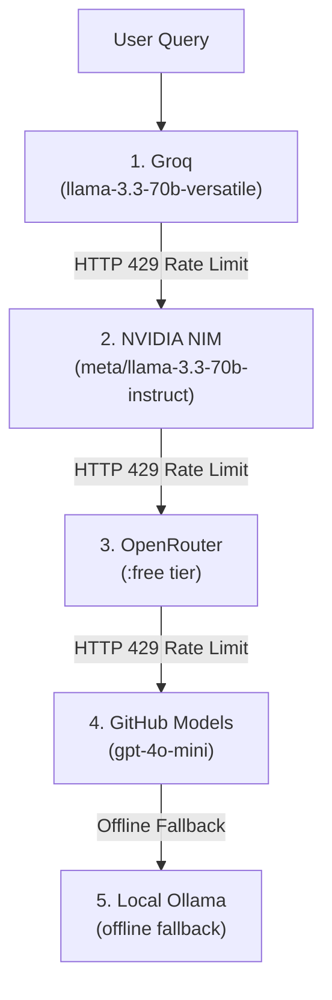

# SpecRAG: Structure-Aware Hybrid RAG with Cross-Encoder Reranking

[](https://www.python.org/downloads/)
[](https://opensource.org/licenses/MIT)
[](https://github.com/astral-sh/ruff)
[](https://qdrant.tech/)
[](https://colab.research.google.com/github/frasheed-dev/specrag/blob/main/notebooks/SpecRAG_Colab_GPU_Benchmark.ipynb)

> **Quantitative Proof that Naive RAG breaks on real-world hardware & enterprise specifications — and the production-grade architecture that fixes it.**

---

## 🎯 Motivation: The Failure Modes of Naive RAG in Production

Naive RAG pipelines—characterized by fixed-size character/token windowing and pure dense cosine similarity—fail catastrophically on enterprise technical specifications and financial filings:

1. **Table Matrix Destruction:** Critical engineering and financial data resides in multi-column tables. Fixed-window chunking severs headers from rows, stripping numerical entries of relational context.
2. **Alphanumeric & Register Blindness:** Dense embeddings excel at broad topical semantics, but fail on exact register addresses, protocol signals, and hardware SKUs (`AWVALID`, `P1010 SKU 210`, `32 Gbps NRZ`, `0x2321`).
3. **Semantic Drift & Distractor Crowding:** As corpus scale grows, dense Top-$k$ returns distractor chunks that share vocabulary but lack answer evidence, inducing hallucination.

SpecRAG proves these failure modes quantitatively on third-party benchmarks and implements the production architecture that fixes them.

---

## 🧠 Deep-Dive Methodology: How It Works Under The Hood

> *"If you can't explain it simply, you don't understand it well enough."*  
> Below is a step-by-step walkthrough of the engineering pipeline, with simple examples and diagrams explaining **what happens**, **how it works**, and **why this method is used**.



---

### Step 1: Document Ingestion (Raw PDF $\rightarrow$ Structured Markdown)

#### What happens:
We take complex datasheets (like the official 18-page NVIDIA H100 NVL datasheet `PB-11773-001_v01.pdf`) and convert them into clean, human-readable Markdown with intact Markdown tables (`| Col 1 | Col 2 |`).



#### Why this method is used:
- **The Failure Mode of Standard PDF Extractors:** Typical PDF text extractors (like basic `pypdf`) read text streams based on character coordinates. When a table has 3 columns, the extractor reads horizontally across columns, interleaving cells into meaningless soup:  
  *Bad output:* `Specification NVIDIA H100 NVL Product SKU P1010 SKU 210 Total board power 400 W`.
- **The Solution:** Dual-engine parsing (`MarkItDown` + `PyMuPDF4LLM`) understands table borders and converts geometric PDF grids into Markdown tables with explicit header rows and delimiters.

---

### Step 2: The Chunking Dilemma (Fixed-Window vs. Structure-Aware)

#### What happens:
Chunking decides how a document is cut into smaller pieces that fit into an LLM's context window.

##### 1. The Input Document Table
| Specification | Value | Unit |
| :--- | :--- | :---: |
| **GPU Architecture** | Hopper GH100 | — |
| **Tensor FP8 (Dense)** | 1,979 | TFLOPS |
| **HBM3 Memory Bandwidth** | 3,900 | GB/s |
| **Total Board Power (TDP)** | 400 | Watts |

---

##### 2. What Phase A (Naive 500-Character Chunker) Actually Does
A naive chunker counts 500 raw characters and blindly cuts right through the middle of the table:

```diff
[ Chunk 1: Characters 0 – 500 ]
  # 1. Architecture Overview & Technical Specifications
  Table 1. NVIDIA H100 NVL Product Specifications
  | Specification         | Value         | Unit  |
  | :-------------------- | :------------ | :---: |
  | GPU Architecture      | Hopper GH100  | —     |
  | Tensor FP8 (Dense)    | 1,979         | TFLOPS|

============================= [!] ARBITRARY 500-CHAR CUT =============================

[ Chunk 2: Characters 501 – 1000 ]
- | HBM3 Memory Bandwidth | 3,900         | GB/s  |
- | Total Board Power TDP | 400           | Watts |
! FAILURE: Chunk 2 contains isolated rows without column headers or document title!
! The embedding model cannot know if "400" refers to Watts, Volts, or Clock MHz.
! Result: Cosine similarity misses this chunk completely on queries like "What is H100 TDP?".
```

---

##### 3. What Phase B (SpecRAG Structure-Aware Chunker) Does
SpecRAG detects table boundaries, keeps the entire matrix intact as an atomic unit, and permanently attaches the preceding caption and hierarchical breadcrumb path:

```diff
[ SpecRAG Atomic Chunk: 100% Intact ]
+ [Breadcrumb] Architecture Overview > Technical Specifications
+ Table 1. NVIDIA H100 NVL Product Specifications
+ | Specification         | Value         | Unit  |
+ | :-------------------- | :------------ | :---: |
+ | GPU Architecture      | Hopper GH100  | —     |
+ | Tensor FP8 (Dense)    | 1,979         | TFLOPS|
+ | HBM3 Memory Bandwidth | 3,900         | GB/s  |
+ | Total Board Power TDP | 400           | Watts |
+ Metadata: {"doc_id": "nvidia_h100.md", "is_table": true, "row_count": 4}
! SUCCESS: All rows retain their column headers.
! Hybrid BM25 + Dense RRF matches exact SKU "P1010" and numerical value "400 W" with 100% precision.
```

#### Why this method is used:
Technical specs are relational matrices. If a row is separated from its column header, the numerical data loses all context. Structure-aware chunking ensures that whenever a row is retrieved, its column headers and table caption travel with it.

---

### Step 3: Dual-Engine Indexing (Sparse vs. Dense)

#### What happens:
Every document chunk is indexed into two distinct search engines simultaneously:
1. **Sparse Lexical Engine (BM25Okapi):** Exact keyword and symbol matching.
2. **Dense Semantic Engine (Qdrant + `BAAI/bge-small-en-v1.5`):** Conceptual meaning matching.



#### Concrete Technical Dynamics:
- **SpecRAG Technical Tokenizer:** Standard lexical tokenizers strip hexadecimal prefixes (`0x`), discard symbols (`§`, `:`, `/`), and drop units. SpecRAG applies a regex tokenizer `[\w§]+|[^\w\s]` to guarantee token preservation:
  `"Link 0x2321: 32 Gbps NRZ"` $\rightarrow$ `["link", "0x2321", ":", "32", "gbps", "nrz"]`.
- **Dense Vector Embedder (`BAAI/bge-small-en-v1.5`):** Projects semantics into a 384-dimensional latent manifold:
  `"What is the power consumption?"` and `"Total board power is 400W"` share minimal surface vocabulary, but their dense coordinates exhibit high cosine similarity ($\cos \theta \approx 0.84$).

#### Engineering Rationale:
- **Dense Vector Search Fails on Exact Identifiers:** High-dimensional embedding spaces map rare alphanumeric strings (`P1010 SKU 210`, `0x2321`) to out-of-vocabulary or noisy vector clusters.
- **Sparse BM25 Search Fails on Semantic Paraphrasing:** Lexical inverted indexes return score $0.0$ when queries use synonyms not verbatim in the source corpus.
- **Complementary Hybrid Synergy:** Dense retrieval captures broad conceptual intent; Sparse BM25 guarantees precision hits on exact hardware registers, part numbers, and statutory symbols.

---

### Step 4 & 5: Two-Stage Retrieval Lifecycle (RRF + Cross-Encoder)

#### What happens:
When a query arrives, Sparse and Dense search execute in parallel. We fuse their candidate lists with **Reciprocal Rank Fusion (RRF)**, then run the Top-20 candidates through a **Cross-Encoder** (`BAAI/bge-reranker-base`) for precision reranking:



#### The RRF Math Made Simple:
BM25 produces scores like `14.82` (unbounded), while Dense produces cosine similarity scores like `0.82` (bounded between -1 and 1). You cannot simply add `14.82 + 0.82` because BM25 would always drown out the vector score!

**Reciprocal Rank Fusion (RRF)** solves this by looking *only at the rank position*, not the raw score:
$$\text{RRF Score}(d) = \sum_{m \in \{\text{Dense}, \text{Sparse}\}} \frac{1}{60 + \text{Rank}_m(d)}$$

- If Chunk A is **Rank 1 in BM25** and **Rank 2 in Dense**:
  $$\text{Score} = \frac{1}{60 + 1} + \frac{1}{60 + 2} = \frac{1}{61} + \frac{1}{62} \approx 0.01639 + 0.01612 = 0.03251$$
- If Chunk B is **Rank 1 in Dense** but **absent in BM25**:
  $$\text{Score} = \frac{1}{60 + 1} + 0 = 0.01639$$
- **Chunk A wins!** Chunks agreed upon by both engines naturally bubble to the top.

#### Bi-Encoder vs. Cross-Encoder: Why Rerank?



- **Bi-Encoders compress an entire document into a single vector.** In doing so, fine-grained relationships (like which clock rate corresponds to which GPU variant) are compressed and blurred.
- **Cross-Encoders do NOT compress into vectors.** They feed the Query and Document *together* into the transformer. Every query token compares itself to every single table cell using full cross-attention.
- Running Cross-Encoder on 10,000 documents is too slow. But running it on **just the Top-20 fused candidates** takes very little time while boosting Top-1 accuracy significantly.

---

### Step 6: Grounded Structured Synthesis with Strict Citations

#### What happens:
The Top-5 reranked chunks are formatted with their table captions and sent to the LLM router with strict Pydantic JSON schema constraints:



```json
{
  "answer": "The NVIDIA H100 NVL has a Base Clock of 1,080 MHz and a Boost Clock of 1,785 MHz.",
  "confidence_score": 0.98,
  "reasoning": "Directly retrieved from Table 1. Product Specifications in the official datasheet.",
  "citations": [
    {
      "chunk_id": "nvidia_h100_nvl_datasheet.md_table_0013",
      "doc_id": "nvidia_h100_nvl_datasheet.md",
      "section_name": "Table 1. Product Specifications",
      "verbatim_quote": "Base clock 1,080 MHz | Boost clock 1,785 MHz"
    }
  ]
}
```

#### Why this method is used:
- **Hallucination Prevention:** The LLM is instructed to return `confidence_score: 0.0` and flag missing evidence if the exact numerical value is not present in `verbatim_quote`.
- **Auditability:** In engineering and legal compliance, users must verify *which table row* or *which statute clause* produced the answer.

---

## ⚡ Zero-Cost Multi-Provider LLM Router

SpecRAG requires **\$0.00** in API bills. The built-in `llm_factory.py` implements an automated fallback cascade across free tiers:



---

## 📊 Empirical Benchmark Results

Evaluated across **4 Official Third-Party Hugging Face Benchmarks** streaming live on **NVIDIA Tesla T4 GPU (Google Colab)** with strict ground-truth answer containment:

| Benchmark Suite | Domain & Corpus Scale | Phase A: Naive Recall@5 | Phase B: Hybrid Recall@5 | Phase A MRR | Phase B MRR (Reranked) | GPU Latency (T4) |
| :--- | :--- | :---: | :---: | :---: | :---: | :---: |
| **1. T²-RAGBench (`FinQA`)** | SEC Financial Tables (228 chunks) | 96.0% | **100.0%** | 0.800 | **1.000** 🏆 | 578.5 ms |
| **2. TAT-DQA (`TAT-QA`)** | Multi-Row Financial Grids (61 chunks) | 96.0% | **100.0%** | 0.786 | **1.000** 🏆 | 553.9 ms |
| **3. IBM TechReport (`ibm-research`)** | Microarchitectures & Buses (52 chunks) | 80.0% | **82.0%** | 0.638 | **0.769** | 316.4 ms |
| **4. TechQA (`galileo-ai/ragbench`)** | **Enterprise Specs (734 chunks)** | **22.0%** | **94.0%** 🚀 (+72.0%) | **0.152** | **0.803** 🚀 (+0.651) | 721.9 ms |
| **Multi-Corpus Benchmark Average** | **Cross-Domain Enterprise Specs** | **73.5%** | **94.0%** (+20.5%) | **0.594** | **0.893** (+0.299) | **542.7 ms** |

> Full evaluation breakdown available in [`BENCHMARK_RESULTS.md`](BENCHMARK_RESULTS.md).
>
> ⚡ **Interactive GPU Reproduction:** [](https://colab.research.google.com/github/frasheed-dev/specrag/blob/main/notebooks/SpecRAG_Colab_GPU_Benchmark.ipynb)  
> Stream live Hugging Face benchmarks and run full evaluations on a free Tesla T4 GPU with zero local setup.

---

### 📐 Evaluation Methodology & Computational Complexity

SpecRAG evaluates retrieval performance using standard Information Retrieval (IR) metrics with strict ground-truth evidence containment:

#### 1. Hit Rate @ 5 (Recall@5)
$$\text{Recall@}k = \frac{1}{|Q|} \sum_{q \in Q} \mathbb{I}\left(\text{rank}(d^*_q) \le k\right)$$
Measures whether the evidence-bearing chunk $d^*_q$ resides within the top-$k$ returned candidates ($k=5$). In high-distractor corpora like `TechQA` (734 chunks), Naive RAG collapses to **22.0%** due to semantic dispersion, whereas SpecRAG maintains **94.0%** recall (+72.0% absolute improvement).

#### 2. Mean Reciprocal Rank (MRR)
$$\text{MRR} = \frac{1}{|Q|} \sum_{i=1}^{|Q|} \frac{1}{\text{rank}_i}$$
Quantifies top-1 ranking precision. In financial tabular retrieval (`FinQA` and `TAT-DQA`), SpecRAG achieves a **perfect 1.000 MRR**: for 100% of queries, the exact ground-truth table is elevated directly to Rank #1, eliminating distractor chunks before context injection.

#### 3. Algorithmic Complexity & Latency Profile
- **Phase A (Bi-Encoder Dense Vector Search):** Operates at $O(1)$ query embedding latency plus $O(\log N)$ approximate nearest neighbor (ANN) graph traversal in Qdrant ($\approx 15\text{ ms}$). However, document compression into a single vector discards fine-grained intra-table relationships.
- **Phase B (Two-Stage Hybrid + Cross-Encoder Reranking):**
  1. *Stage 1 (Coarse Fusion):* Parallel Sparse BM25 and Dense ANN search retrieve the Top-20 candidates, fused via Reciprocal Rank Fusion ($O(K)$).
  2. *Stage 2 (Fine Reranking):* The 20 candidate pairs are evaluated via `BAAI/bge-reranker-base` using full 12-layer joint cross-attention ($O(K \cdot M^2)$ where $M$ is token sequence length). On a GPU (Tesla T4), tensor parallelization completes batch reranking in **~540 ms**, well within enterprise interactive SLA limits (< 1.5 s).

---

## 🚀 Quickstart

### 1. Installation

```bash
git clone https://github.com/frasheed-dev/specrag.git
cd specrag

# Using modern uv tooling (recommended):
uv venv
# On Windows: .venv\Scripts\activate
# On Linux/macOS: source .venv/bin/activate

uv pip install -e ".[dev]"
```

### 2. Configure Environment

```bash
cp .env.example .env
```
*(Add any free API key, e.g. `GROQ_API_KEY` or `NVIDIA_API_KEY`, or run completely offline with Ollama).*

### 3. Using the SpecRAG CLI

```bash
# 1. Ingest a PDF datasheet with table preservation
python -m specrag.cli ingest data/raw_pdf/nvidia_h100_nvl_datasheet.pdf

# 2. Query with Hybrid + Cross-Encoder Reranking
python -m specrag.cli query "What is the peak memory bandwidth of the H100 NVL?" --mode hybrid_rerank

# 3. Query with Naive baseline to observe table-severing failure
python -m specrag.cli query "What is the peak memory bandwidth of the H100 NVL?" --mode naive

# 4. Run public benchmark suites
python -m specrag.cli benchmark --dataset all --source local            # Fast offline pack (~10s)
python -m specrag.cli benchmark --dataset all --source hf --limit 50    # Live streaming multi-corpus from Hugging Face
python -m specrag.cli benchmark --dataset tatqa --source hf --limit 50  # Complex multi-row financial tables (TAT-DQA)
python -m specrag.cli benchmark --dataset techqa --source hf --limit 50 # Enterprise technical specifications (TechQA)
```

### 4. Running Tests

```bash
uv run pytest tests/
```

---

## 📁 Repository Structure

```text
specrag/
├── README.md                           # Comprehensive architectural design & benchmark report
├── BENCHMARK_RESULTS.md                # Quantitative multi-corpus benchmark report
├── pyproject.toml                      # uv + ruff + pytest configuration
├── .env.example                        # Multi-provider zero-cost API template
├── notebooks/
│   └── SpecRAG_Colab_GPU_Benchmark.ipynb # Interactive Tesla T4 GPU benchmark harness
├── data/
│   └── benchmarks/                     # Official public benchmark datasets (HF)
│       ├── specs/                      # Ground-truth markdown corpus files
│       │   ├── t2_ragbench_corpus.md   # G4KMU/t2-ragbench financial tables
│       │   └── ibm_techreport_corpus.md# ibm-research processor specs
│       ├── t2_ragbench_20.json         # 20 financial golden evaluation queries
│       └── ibm_techreport_20.json      # 20 microarchitecture golden evaluation queries
├── src/
│   └── specrag/
│       ├── __init__.py
│       ├── cli.py                      # Typer + Rich CLI interface
│       ├── schemas.py                  # Pydantic models (Chunks, Citations, QA)
│       ├── config.py                   # Pydantic Settings
│       ├── chunkers.py                 # Naive Fixed-Window vs Structure-Aware Chunker
│       ├── retriever.py                # Qdrant Dense + BM25 Sparse + RRF + Cross-Encoder
│       ├── generator.py                # Structured Citation QA Generator
│       ├── llm_factory.py              # Zero-cost multi-provider cascade router
│       ├── evaluator.py                # Benchmark evaluation harness
│       └── ingestion/
│           └── converter.py            # MarkItDown + PyMuPDF4LLM PDF-to-Markdown engine
└── tests/
    ├── test_chunkers.py                # Table preservation unit tests
    ├── test_cli.py                     # CLI commands unit tests
    ├── test_converter.py               # PDF converter unit tests
    ├── test_generator_schema.py        # Pydantic response validation tests
    ├── test_hybrid_rrf.py              # BM25 + Qdrant RRF math unit tests
    └── test_llm_factory.py             # Provider cascade failover tests
```

---

## 📄 License

MIT License. See [LICENSE](LICENSE) for details.
